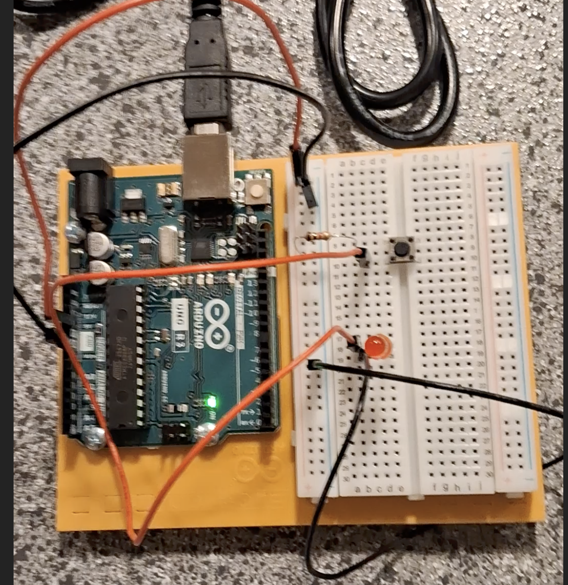

# Project 01 - Button and LED

This first project is an introduction to the Arduino Starter Kit tools and basic wiring.

## Goal

Pressing a pushbutton makes the LED blink.

## What I Practiced

- Identifying basic components (Arduino, breadboard, LED, resistor, pushbutton, jumper wires)
- Building a simple input/output circuit
- Reading a button state from a digital pin
- Controlling an LED with basic sketch logic

## Demo Image

## Demo Video

- [Watch the demo](../../assets/videos/project-01-demo.mp4)

## Sketch

- `Project-01-Button-and-LED/Project-01-Button-and-LED.ino`

## Notes

- This project is a fundamentals warm-up before later Starter Kit projects.
